<h1 align="center">
  
</h1>

<p align="center">
  
</p>

```bash
unexceo@github:~$ cat about.txt
```

- 👨‍💻 Developer who loves building and experimenting
- 🌱 Currently learning new things every day
- 📫 Reach me: [GitHub](https://github.com/unexceo)

---

### 🛠️ Tech Stack

<p align="center">
  
  
  
  
  
</p>

---

### 📊 GitHub Stats

<p align="center">
  
  
</p>

<p align="center">
  
</p>

### 📈 Contribution Graph

<p align="center">
  
</p>

---

<p align="center">
  
</p>
